# Business completeness review — 7 October 2026

> **Superseded for status (14 Nov 2026).** This is a dated record of an earlier increment, kept as written. For what the platform does now, see the [capability matrix](capabilities.md) and [ROADMAP.md](../ROADMAP.md); file paths, counts and limits below are as they were when this was written ([historical paths](capabilities.md#older-documents-and-historical-paths)).

The platform has a usable audit workbench, evidence custody, model/evaluation lineage, human paper review and immutable report snapshots. It still needs an approved operating model around those records before it can support a complete enterprise audit. This review separates the hosted implementation from templates, specifications and remaining acceptance work.

## What the auditor must be able to defend

The audited object is an AI system in its intended use: its model, preprocessing, data, deployment, decisions, people and controls. The business record should answer: who engaged us; what system, period and use were assessed; which duties applied to which actor; what procedures we agreed; what evidence we obtained; what remained uncertain; who approved the conclusion; and who received the exact report.

```mermaid
flowchart LR
  A[Approved mandate and system boundary] --> B[Reviewed applicability and criteria]
  B --> C[Approved procedures and sampling]
  C --> D[Evidence requests and collection]
  D --> E[Execution and human evidence evaluation]
  E --> F[Findings, responses and limitations]
  F --> G[Independent review and scoped opinion]
  G --> H[Approved report and client release]
  H --> I[Remediation, changes and monitoring]
```

Classification and Articles 9–15 do not cover the whole engagement. A duty register must also consider actor-dependent governance, conformity and operational duties. Examples include provider quality management, fundamental-rights impact assessment for specified deployers, and post-market monitoring. Assess each duty's actor, scope and applicable period; do not make every duty universal or treat a diagnostic pass as a legal conclusion. Sources: [Commission Article 17](https://ai-act-service-desk.ec.europa.eu/en/ai-act/article-17), [Article 27](https://ai-act-service-desk.ec.europa.eu/en/ai-act/article-27), [Article 72](https://ai-act-service-desk.ec.europa.eu/en/ai-act/article-72). Preserve the versioned legal basis described in [the methodology](audit-methodology.md), including the [current consolidated text](https://eur-lex.europa.eu/legal-content/EN/TXT/?uri=CELEX:02024R1689-20260727). An assurance report is not a notified-body certificate.

## Implemented in this increment

| Business need | Operational behavior |
| --- | --- |
| Know what to do next | The workbench prioritizes earlier/current-stage papers, separates team obligations and keeps later preparation collapsed. Reviews and open comments stay actionable. |
| Know why progression is blocked | Stage and opinion-specific final-report checks share server rules and link directly to the records needing work. Sign-off remains mandatory for final creation. |
| Ask for specific evidence | Evidence vault → Requests records expected deliverable/purpose, responsible party, period/version, collection instructions, deadline and supported papers. Search, outstanding/overdue/assessment views and a downloadable checklist are available. |
| Distinguish arrival from sufficiency | An auditor links received files and records provenance. A separate explicit assessment either records sufficient evidence for the planned procedure or requests more material, with a reasoned narrative. File-handling acceptance alone does not assess sufficiency. |
| Handle unavailable material | Only a Lead can record unobtainable evidence or a scope change. The same transaction creates a required, unevaluated limitation/scope memo. It needs accepted support for the decision, a human conclusion and independent review/sign-off. No legal obligation is waived automatically. |
| Preserve decisions | Request changes retain prior revisions, relationships, responsible party, collection instructions, receipt and assessment. Full internal report snapshots capture requests. Reopening a request does not alter signed papers or issued reports. |
| Avoid an unsupported positive opinion | Final readiness issuance is blocked by required unresolved requests, unobtainable evidence, unsupported/qualified required signed conclusions, prohibited-practice classification and existing High/Critical finding gates. A scoped negative/qualified opinion still requires the other completion gates. Drafts may capture outstanding work. |
| Keep client access bounded | Client Viewer remains read-only. Internal requests and their history are excluded from workspace/report/print client projections. A generic availability-limitation notice refers the reader to the human-written scoped opinion and summary. |

New requests require a documented disposition before Reporting/Sign-off. Existing engagements without requests remain compatible. Collection is auditor-recorded; client uploads, messaging, reminders and authenticated client submissions are not implemented by this register. The checklist can be distributed through the organization's approved channel. Responsible-party text is not a user assignment or access grant.

A limitation memo must be supported even when the requested material is missing. Suitable support can include accepted correspondence, documented collection attempts or the approved scope decision. Later obtaining the material requires reassessing any existing limitation memo; its old conclusion is not silently replaced.

## Remaining business priorities and acceptance criteria

| Priority | Current boundary | Next business capability | Completion evidence |
| --- | --- | --- | --- |
| 1. Mandate and system boundary | Planning/acceptance templates exist; scope is mainly narrative. | Versioned mandate with audit period, deliverables, intended audience, assurance/procedure basis, system components/deployment, actor responsibilities, access constraints, independence assessment, exclusions and approved scope changes. | Fieldwork uses an approved mandate version. Material changes record impact and approval. Reports freeze that mandate. |
| 2. Applicable duty and criterion register | Guided classification, legal snapshot, paper exclusions and Annex IV candidate mapping exist. They do not establish reviewed subitem compliance. | Each obligation/subitem has source version, actor, effective-period analysis, applicable/readiness/not-applicable/uncertain decision, rationale and reviewer. Select conformity/registration/sectoral and transparency duties where relevant. | A reviewer can explain every inclusion/exclusion. Unknown facts remain unresolved; a prohibited route cannot become positive readiness by signing ordinary papers. |
| 3. Executed procedure and evidence assessment | Requests and papers link files/runs, but procedure, sampling and results are largely narratives. | Structured procedure/assertion records with population, sample selection, approved thresholds, execution, contradictions and exact evidence/run references; separate design and operating-effectiveness conclusions. | Trace criterion → population/sample → procedure → versioned evidence/run → human assessment → finding → report. Omitted work requires an approved limitation. |
| 4. Team and review handoff | Preparers/contributors, independent reviews and revision-bound signatures exist; practice membership supplies access. | Engagement grants plus authorized reviewer assignments, due dates, workload handoff and attributed responses to review comments. | Assignment never grants access implicitly. Eligible independent reviewers receive exact revisions. Prior contributors and stale approvals remain rejected. |
| 5. Substantiated findings and follow-up | Risk/owner/due date, management response, remediation evidence and independent closure checks exist. | Originating criterion/paper/run/evidence references, attributed management responses/disagreements, explicit retest procedures/results, closure rationale and controlled reopening. | Fresh evidence demonstrates effective remediation. Recurrence retains previous closure and issued-report history. Risk acceptance does not erase a nonconformity. |
| 6. Report approval, release and correction | Immutable final snapshots and restricted client projections exist. Creating a final report currently makes that projection available. | Separate approval of exact internal package and client projection, release authorization, recipient/access scope, distribution record, supersession and withdrawal. | Unreleased finals remain internal. Corrections create a new immutable package linked to its predecessor. Release/withdrawal decisions are attributable and auditable. |
| 7. Monitoring and reassessment | Monitoring/change/incident memo templates exist; no complete operational schedule or incident workflow. | Named monitoring owners, cadence, change/incident records, impact triage, escalation, follow-up evidence and new/reopened engagements. | Material purpose/model/data/pipeline or rule changes trigger human reassessment. Earlier conclusions remain fixed. |

The next product increment should implement priorities 1 and 2 together: a short **Engagement setup** workflow followed by an **Audit program** that shows the actual approved duties/procedures. Avoid adding another general dashboard. Keep classification, evidence requests, testing and papers as connected steps in that program. Priority 6 should precede broad client onboarding.

## Common business model to extend

These are proposed records, not deployed tables: `MandateRevision`, `AuditedSystemRevision`, `ActorResponsibility`, `ObligationAssessment`, `PlannedProcedure`, `ProcedureExecution`, `EvidenceAssessment`, `TeamAssignment`, `FindingSupport`, `ReportApproval`, `ReportRelease`, `ReportSupersession` and `MonitoringCase`. Each carries tenant/engagement scope, actor/time, version, status, rationale and explicit links. Approvals bind an exact revision; a change creates impact review without rewriting captured reports. Enforce the same authorization, same-engagement references and atomic concurrency guard already used by requests.

Automation should bind its frozen model/dataset/protocol manifest to an approved procedure. It supplies diagnostic results and a draft assessment packet; a person evaluates representativeness, uncertainty, conflicting evidence and the criterion. Hosted saved-prediction diagnostics do not establish independent model inference, training reproduction or production behavior. The external native runner, distributed worker integration, advanced suites and production controls retain the acceptance work in [the implementation roadmap](implementation-roadmap.md).

## Definition of an end-to-end pilot

Use two supervised fictional case files: one supported scoped conclusion and one material evidence limitation. Demonstrate acceptance/independence, approved mandate, reviewed duties, planned/manual/automated procedures, evidence follow-up, sufficient and contradictory evidence, management disagreement, independent review, exact report approval/release and subsequent remediation/change reassessment. Preserve the complete trace in each case. The current test suite verifies many components of this chain; it does not yet demonstrate the whole pilot.

Production acceptance additionally requires enterprise identity/provisioning, durable isolated workers, retention/hold, verified signing and recovery, load/security/accessibility work and approved methodology ownership. These are operational release criteria, not extra labels in the UI.

## Validation of the current increment

TypeScript and workflow/register checks passed. The rebuilt isolated Worker integration covers request roles, calendar/reference validation, receipt versus sufficiency, returned/resubmitted material, Lead-only exceptions, concurrent rejection without an extra memo, frozen request snapshots, lifecycle gates, positive-opinion protections and client workspace/report/print redaction. Browser checks use fictional local records and verify contextual handoffs and responsive layouts. No production records were populated for QA. See [the validation record](validation-results.md).
