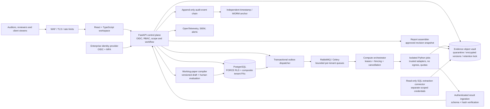
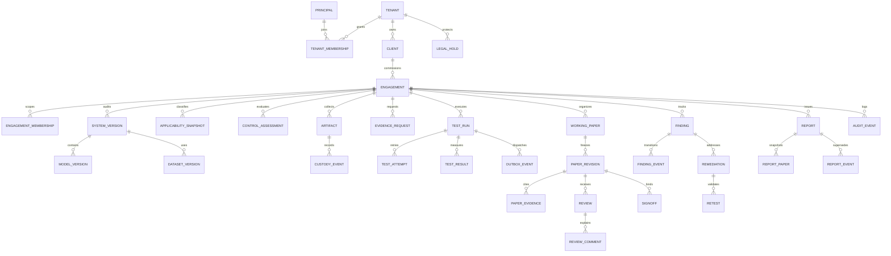

# AI Assurance platform — production architecture

Design baseline: 5 October 2026. This document describes the target production system. The runnable application in this repository is a control-plane reference implementation; the controls and services below must pass the acceptance gates in `implementation-roadmap.md` before production use.

The platform manages evidence, testing and independent audit decisions for traditional ML. A diagnostic threshold result is evidence about a defined population and method. It is not an EU AI Act compliance decision, conformity assessment, certification, or legal opinion. Applicability, sufficiency of evidence, residual risk and the engagement conclusion require identified human reviewers.

## 1. System boundaries and ownership

An audit firm is a **Tenant**. It owns many **Clients**. Each Client owns many **Engagements**, each tied to explicit AI-system versions, a defined intended purpose, actor roles and audit period. Separate client organizations do not become interchangeable with tenant boundaries: every client user's access is restricted to assigned engagements and released material. A firm can isolate a particularly sensitive client into a separate tenant/database/key partition.

An engagement can cover multiple related models, datasets, pipeline versions and deployments. A model alone is not the AI system: interfaces, people, instructions, intended use, downstream decisions, oversight, monitoring and change management are in scope. Reuse of a model does not imply reuse of its risk classification or an earlier conclusion.



The browser never receives DB credentials, object-store credentials, raw tenant keys or compute cluster access. The API alone resolves object IDs to authorization-scoped, short-lived URLs. Object keys are generated by the service, never accepted from a caller. Workers receive the minimum input artifacts and a signed job envelope; they do not have broad access to all tenants or the relational database.

## 2. Recommended stack and deployment

| Area | Choice | Reason / boundary |
|---|---|---|
| Workspace | React, TypeScript, accessible component primitives | Typed contracts, familiar maintainable UI; no regulatory decision in the browser |
| Control-plane API | FastAPI + Pydantic, SQLAlchemy + Alembic | Python/ML ecosystem and explicit API validation; authorization remains service-side |
| Relational state | Supported PostgreSQL version, managed HA | Transactions, composite keys, RLS, JSONB contracts and immutable revision references |
| Async computation | Celery with RabbitMQ; job state in PostgreSQL | Separates control requests from long ML work; broker state is not authoritative |
| ML adapters | Pinned Python images: sklearn, XGBoost, LightGBM, ONNX Runtime and vetted PMML runtime | Explicit support matrix and offline dependency locks; uploaded code cannot choose libraries |
| Diagnostics | Pinned SHAP/LIME or suitable explainers, scipy metrics, vetted robustness library | Applicability registry, uncertainty and limitations captured per test |
| Evidence | S3-compatible encrypted object store with versioning / retention-lock support | Large immutable objects, quarantine and signed manifests; storage lock validated on selected provider |
| Identity | Existing enterprise OIDC provider; authorization-code flow with PKCE | MFA, lifecycle provisioning, issuer/subject identity and short sessions |
| Secrets / signing | Managed secret store + KMS/HSM | Tenant key isolation, rotation and signed evidence/report manifests |
| Infra | Containers, infrastructure as code; Kubernetes when workload justifies it | Separate API/worker trust domains, network policy, quotas, region pinning |
| Operations | OpenTelemetry + central SIEM, managed metrics | Queue age, denied requests, evidence verification and tamper signals |
| Export | Server-generated PDF plus machine-readable signed bundle | A report remains independently verifiable after platform access ends |

The repository's TypeScript worker/control-plane app uses private D1 tenant, membership and client records with versioned engagement aggregate state, append-only snapshots/events and an object bucket. It can be used for a supervised prototype. Its interactive saved-prediction procedures compute actual metrics, with a deliberately limited scope; external Python diagnostics extend that scope. Full model ingestion/inference, explanations and isolated distributed execution require the production testing plane. Seeded records and unsupported capabilities must be labelled clearly. Do not describe prototype storage/authentication as PostgreSQL RLS, OIDC, WORM or sandbox execution.

Pin versions with reproducible builds and automated dependency/security review. Publish an adapter support matrix per runner image: format, library version, task, predict/predict_proba behavior, sparse/text support, preprocessing, explanation support and unsupported operations. ONNX/PMML portability does not guarantee that every operator or model is supported.

## 3. Identity, authorization and isolation

* Identify users by verified `(issuer, subject)`; email is display/contact data, not a stable principal key. Check signature algorithm, issuer, audience, expiry, nonce and session lifecycle. Re-authenticate for report issuance and other high-impact approvals. [OpenID Connect Core](https://openid.net/specs/openid-connect-core-1_0.html).
* A request selects a tenant only after active tenant membership is verified. Tenant membership does not confer access to every client or engagement. Engagement role assignments are explicit, expiry-aware and audited.
* Auditor: evidence intake, draft papers, execute approved tests and propose findings. Lead Auditor: approve plan and thresholds, assign scoped team members, accept scope limitations and issue reports when independence gates pass. Reviewer: independent review, return/reject/approve a specific revision and independently retest remediation. Client Viewer: only client-released evidence requests, papers and reports; may submit responses through a separate controlled command, never approve audit work.
* Tenant administrator: manages tenant settings and identity assignments, with no automatic access to audit content. Operational administrators use separately recorded, time-bound break-glass access; every use is alerted and reviewed.
* All tenant-bearing tables use `tenant_id`, composite foreign keys and FORCE RLS. All engagement-bearing records also constrain `(tenant_id, engagement_id)`; model/dataset/run/paper links constrain the same engagement. Resource authorization is repeated for downloads, exports, background callbacks, search results and bulk APIs.
* API DB connections use a non-owner, non-superuser, non-BYPASSRLS role, a transaction per request and transaction-local verified subject/tenant settings. Empty settings deny access. These settings are not authentication credentials: do not expose a SQL connection or arbitrary SQL endpoint that lets callers set them.
* The SQL baseline uses RLS to provide tenant and engagement scope plus coarse role gates; command handlers enforce state, independence, visibility and allowed columns. Production API commands should use narrow stored procedures or tightly reviewed transaction repositories, with direct table writes restricted further. Never allow general JSON updates to authorization, approvals or report issuance.

PostgreSQL owners and bypass roles can circumvent ordinary RLS, and global operations such as TRUNCATE do not use row policies. FORCE RLS and least-privileged roles therefore complement, rather than replace, grants and access tests. [PostgreSQL row security](https://www.postgresql.org/docs/current/ddl-rowsecurity.html).

## 4. Relational model



`db/postgres.sql` is an initial migration baseline, not proof of a deployed service. Core design invariants:

1. An entity ID cannot be linked across tenants or engagements through a foreign key. No cross-tenant delete cascades. The firm/client hierarchy is distinct from system/model versions.
2. Templates, control catalog versions, legal rulesets, assessments, runs, revision content and signed reports have explicit versions. Existing engagements retain their ruleset; updates create an impact-review task.
3. Artifact metadata binds storage key and object version to SHA-256, size, MIME, classification, submitter, intake time, scanner result, retention deadline, legal hold and a signed manifest. Do not deduplicate raw evidence globally across tenants.
4. A working paper has editable drafting state and append-only frozen revisions. Reviews and signoffs refer to exact revision IDs and hashes. Pending draft changes mark current approvals stale; clearing that state requires publishing a new revision. Revision pointers advance monotonically, so a rollback requires a fresh reasoned revision. Publishing a new revision leaves old signatures intact but marks them inapplicable to the current version. A report captures its own exact approved revision set. Client release is a separate append-only decision, with revocation and a reviewed projection hash; mutable drafts are never client-readable.
5. Findings preserve condition, criteria, cause, consequence, likelihood, impact, severity, recommendation, owner, due date, management response, disagreements and disposition. Accepting risk is not the same as correcting a statutory nonconformity.
6. Job state changes compare expected state/lease fencing token; results cannot overwrite a newer attempt. Outbox records and job creation commit together.

## 5. Regulatory applicability and control catalog

The versioned applicability assessment first records whether an AI system is in scope, the territorial/material scope, intended purpose, sector, actor roles, exclusions, use cases and significant modifications. It records a reasoned conclusion, relevant provisions, dates, supporting evidence and reviewer. Risk routing can include prohibited practices, high risk, transparency obligations, or other/minimal-risk uses; these are a user-facing routing aid rather than a substitute for the Act's detailed legal structure. Multiple obligations can apply concurrently. Unknown facts produce `needs_information`, not a default minimal-risk result.

The Art. 9–15 / Annex IV control set is one module. Versioned modules also cover duties applicable to providers, deployers, importers/distributors and other actors; relevant provider governance/quality management, logs, conformity pathway, declarations/registration/marking where applicable, post-market monitoring, serious-incident handling, cooperation, deployer operation/oversight and monitoring, and rights-impact obligations where applicable. Data-protection/privacy requirements are assessed separately and linked. Verify the current law, phase-in dates, amendments and guidance against the legal mapping document before activating a ruleset.

Control assessment states: `not_started`, `evidence_requested`, `in_progress`, `ready_for_review`, `satisfied`, `partially_satisfied`, `not_satisfied`, `not_applicable`, `unable_to_conclude`. `not_applicable` requires a reason and approval. Each assessment binds criteria version, actor duty, audit procedure, evidence, paper revision, finding and human conclusion. A green metric cannot set a control to satisfied automatically.

## 6. Standard workspace and lifecycle

```text
00_Administration/ engagement letter, scope, independence, staffing, change log
01_Planning/ system inventory, applicability, risk assessment, control matrix, audit plan
02_Evidence_Vault/ governance, datasets, training, validation, deployment, logs, code, oversight
03_Fieldwork/ data quality, fairness, performance, explanations, drift, robustness, security
04_Control_Evaluation/ Article control papers, Annex IV index, residual-risk memo
05_Findings_Remediation/ findings, client responses, action plans, retests, disagreements
06_Reporting/ draft report, completeness checklist, approved report and signed bundle
07_Review_Signoff/ review notes, revision-specific approvals, closing memo
08_Post_Audit/ follow-up, changes, monitoring, incidents, retention and legal holds
```

Folder names are presentation; storage authorization uses IDs and scope, never a pathname. Templates have stable codes and versions. Every engagement is instantiated from a versioned template pack; optional controls have approved exclusion reasons.

| Stage | Inputs / outputs | Exit gates |
|---|---|---|
| Planning | Acceptance/independence memo; engagement letter; system inventory; applicability; inherent risk; audit plan; threshold/sampling memo | Approved scope and actor duties; evidence requests assigned; reviewer independent; proposed thresholds frozen before test runs |
| Fieldwork | Custody-checked artifacts; automated runs; interview/walkthrough memos; design and operating-effectiveness testing | All planned procedures executed or approved limitation; reliable run provenance; missing evidence flagged |
| Evidence evaluation | Procedure results; manual control conclusions; discrepancy memo; findings and responses | Evidence relevance/reliability assessed; contradictory evidence resolved or disclosed; each conclusion traceable |
| Reporting | Executive and detailed report; Annex IV evidence index; residual-risk memo; limitations and outstanding findings | Completeness checks, exact signed revisions, review notes resolved, no hidden failures or unsupported assurances |
| Sign-off / close | Lead issuance, independent review, immutable bundle, client release record, closing memo | Separation of duties; manifest verified; retention/hold policy applied; post-audit obligations assigned |

Working-paper schema: `schemas/working-paper.schema.json`, the single working-paper contract. A catalog revision (`paperRevision`) records scope and criteria, approved applicability, risk references, procedures with approved criteria, samples and linked evidence/runs/findings, evidence references with hashes and reliability, the evaluation and auditor conclusion, review comments, approvals bound to the revision's content digest, and provenance; its status determines which of these must be complete. Memos use the same revision envelope, with their narrative drafted from the memo templates. Engine-generated diagnostic drafts (`generatedDraft`) always require human review and carry no sign-offs. Interview notes distinguish statements from corroborated evidence; a client statement alone is not an operating-effectiveness conclusion.

## 7. Automation contract and reliable pipeline

The common contract in `schemas/test-run.schema.json` has version `1.0`. It identifies engagement, model/dataset versions, suite IDs as strings, frozen thresholds, seed, state, outcome, rich diagnostic results, actual input hashes, runner version and resulting paper IDs. Optional production extensions include system versions, suite definitions, sampling/splits, approved threshold metadata, runner image and confidence/per-slice provenance. The Python saved-prediction runner hashes the data/reference bytes it actually consumes; a model-metadata hash must be distinguished from a model-binary hash. Contract validation is required at ingress and result ingestion. JSON-schema validation is followed by semantic validation: hashes agree with vault records, input versions belong to the same engagement, metric denominators/intervals are consistent, and approved applicability/threshold versions match.

1. **Intake:** create evidence request or artifact upload intent after permission/quota check. Upload directly to quarantined storage via scoped URL. Verify bytes, hash, format, decompression bounds and malware; scanning does not make model deserialization safe. A SQL connector extracts a defined read-only snapshot with snapshot/query hash, source timestamp and row count; bind secrets by reference and record lawful authority. Raw credentials and row values never enter job messages/audit events.
2. **Registration:** bind immutable model/dataset versions to AI-system version. Require task, label and prediction semantics, features/dtypes/order, preprocessing/tokenization version, categorical handling, sensitive-attribute access basis, missing-value policy and intended-use context. Validate batch predictions against a fixture before use.
3. **Plan:** select eligible tests from a versioned registry. Record hypothesis, population, reference/current windows, slices, sample minimum, positive class, score threshold, confidence method, multiple-comparison policy and limitations. Approve thresholds before execution; a changed plan creates a new run.
4. **Submit:** one DB transaction inserts `test_run`, frozen input/threshold snapshot, audit event and outbox event. Idempotency key is unique per tenant/engagement/command; reuse with a changed request hash returns conflict. Quotas enforce concurrent jobs, data volume, compute time and tenant fairness.
5. **Dispatch:** poll outbox with `FOR UPDATE SKIP LOCKED`; lease and publish a minimal envelope. Broker redelivery is expected. A job claims one attempt with an expiring lease, a monotonic fencing token and heartbeat. Broker task IDs do not determine the authoritative result.
6. **Execute:** use a short-lived isolated job with read-only inputs, ephemeral filesystem, CPU/RAM/time/disk quotas, seccomp or stronger VM isolation, no outbound network and no shared tenant mounts. Never load user pickle/joblib in the API or long-lived worker. sklearn's documentation warns that pickle-family formats may execute arbitrary code, so native Python models require a separately reviewed isolation path or conversion in the isolated environment. [scikit-learn model persistence](https://scikit-learn.org/stable/model_persistence.html).
7. **Commit results:** runner writes immutable result/plot objects; callback verifies service identity, run/attempt/fencing token, full schema, input/output hashes and cancellation state. Append attempt record and approved results exactly once. Duplicate completion is a no-op; stale completion is retained as rejected telemetry, never attached as current evidence.
8. **Compile papers:** map metrics to predetermined procedure sections, provide method and uncertainty, attach run/evidence references, and generate a draft narrative. A reviewer must evaluate relevance, gaps and residual risk. Compiler retries use `(run_id, template_version)` uniqueness and never overwrite an edited paper.
9. **Freeze/report:** human evaluates and publishes a paper revision, resolves review notes and signs exact hashes. Report assembly checks a frozen manifest of approved revisions, findings, scope, applicability and limitations. Generate PDF + JSON evidence index + signature + provenance bundle. Issue once; corrections become a superseding report with a reason.

Celery tasks should be idempotent. Late acknowledgement is useful for appropriate tasks but does not alone ensure recovery for every worker termination. Separate long jobs, timeout external I/O and implement DB leases/reconciliation rather than relying on broker assumptions. [Celery task guidance](https://docs.celeryq.dev/en/stable/userguide/tasks.html).

Retry transient failures only (transport, permitted infrastructure unavailability); do not blindly retry invalid input or deterministic numerical failure. Use exponential backoff with jitter, an attempt cap, dead-letter queue and an operator-visible failed state. Cancellation sets a durable request, signals the orchestrator, stops compute where possible and fences output acceptance. Partial diagnostics are stored with `inconclusive`; cancellation never creates a pass. A reconciler detects stale leases, lost dispatches, missing callbacks, orphan outputs and reports blocked by unfinished runs.

## 8. ML procedure rules and interpretation

* **Fairness:** binary/multiclass treatment and positive outcome are explicit. Demographic parity compares selection rates; disparate impact records reference and compared groups; equalized odds records TPR/FPR using labelled outcomes. Record numerators/denominators, confidence intervals, missing sensitive attributes, intersectional slices, minimum sample rules and tradeoffs. Undefined denominators or absent groups yield inconclusive. Thresholds such as 0.8 are contextual audit policies, not EU AI Act safe harbors.
* **Regression fairness:** specify a task-appropriate error/outcome disparity instead of pretending classification metrics apply. Classical NLP captures tokenization/language/subpopulation coverage and possible proxy features; report coverage limits.
* **Explainability:** validate predict/predict_proba semantics and output shape. Store SHAP/LIME background selection, explanation target, randomness, kernel/perturbation settings and stability checks. Correlated features and explanation assumptions are disclosed. Permutation importance evaluates on held-out data. Local explanations do not demonstrate legal transparency or human comprehension by themselves.
* **Drift:** freeze reference/current windows, preprocessing, PSI bins and smoothing, KS assumptions, Wasserstein units and categorical method. Separate distribution drift, label/performance drift and concept drift. Large-sample significance alone is not operational materiality; small samples reduce power. Apply effect-size and multiple-testing rules.
* **Performance:** choose task-appropriate metrics (confusion rates, precision/recall, AUROC/PR, calibration, MAE/RMSE and interval coverage) with prevalence and costs. Stratified/grouped/time-series splits follow intended use; keep the final holdout untouched. Prevent leakage through preprocessing fitted outside training folds. Audit an existing model with fixed holdout data; do not silently retrain it to create cross-validation scores. Cross-validation requires reproducible training code and becomes a separate training-reproduction procedure.
* **Robustness/security:** perturb only feasible inputs with domain constraints, budgets and threat model. Log before/after predictions and realistic harm scenarios. Missing-value and out-of-range behavior, pipeline dependencies, artifact signatures, access controls, supply-chain review, interfaces and incident response complement adversarial diagnostics. A score alone cannot establish cybersecurity.
* **Logging/oversight:** Art. 12 procedures inspect log design, completeness, clock synchronization, retention and incident traceability using deployed evidence; metric execution logs are not substitutes for inference logs. Art. 14 procedures examine assigned authority, training, escalation, overrides, automation bias and walkthrough evidence.

## 9. Integrity, retention and privacy

Artifact and report manifests use canonical encoding, algorithm identifiers, content hashes, object-version IDs, signing key version and signature timestamp. Verify bytes on ingestion, before compute, before report issuance and periodically in storage. Upload/delete/download actions have custody events. A storage URL is not a manifest signature.

Audit events include tenant/engagement, actor/service, UTC time, command/request ID, action, object reference, relevant old/new hashes and prior event hash. Append operations serialize per tenant/engagement stream; compute event hash over canonical serialized data, not ambiguous string concatenation. Seal batches/Merkle roots to an independent WORM/timestamp service and store receipts outside the application-admin trust boundary. An internal hash chain detects some modifications but cannot alone prevent an administrator from rebuilding history.

Apply a versioned retention policy to object and metadata categories. Do not assign one universal period to all records: distinguish audit evidence, provider/deployer duty records, logs, personal information and operational telemetry; capture actor/jurisdiction/purpose/legal basis and current legal retention requirements. Legal holds suspend eligible destruction with approver, reason and scope. Destruction runs are dual-approved and generate tombstones and destruction receipts. Immutability lasts for the required period, not forever; minimization/pseudonymization and controlled evidence views reduce the privacy/retention conflict. Privacy requests, special-category data, cross-border transfers, regional storage and extraction rights are reviewed and recorded separately.

## 10. Production nonfunctional requirements

Initial targets to ratify with the client: API 99.9% monthly availability; normal metadata requests p95 below 500 ms at agreed load; evidence upload resumable; run progress visible within 30 seconds; RPO 15 minutes and RTO 4 hours for core records. Compute turnaround depends on model/data size and declared quota, never an unconditional UI promise. Restore tests must include signed evidence, identity assignments, encryption/signing keys and outbox replay.

Require isolation tests for tenant guessing, client viewer leakage, revoked membership, exports/search, signed URL reuse, model/data cross-scope references and worker callbacks. Require malicious-artifact tests, memory/decompression quotas, no-egress verification, signature/tamper detection, concurrent edits/signoffs, lost-worker/retry/cancellation tests and deterministic fixtures for every metric adapter. Accessibility, clear units, timezone display, filtering without hidden findings, complete export and redaction review are product acceptance criteria.

Migration safety: versioned forward migrations; DB backup/restore check before destructive changes; expand/migrate/contract deployment; backfill tenant keys and validate composite constraints before enabling access; test every RLS policy using runtime roles; never let automatic ORM startup recreate tables. Operations runbooks cover compromised artifacts, leaked links, identity revocation, failed runners, evidence hash mismatch, key rotation, legal hold, privacy requests, recovery and report supersession.
